<div align="center">

<h1>🎬 Movies</h1>

<h3>اكتشف فيلمك القادم، احفظه، وشاهده من مكان واحد</h3>

<p>تطبيق Flutter للأفلام بتصميم داكن ولمسات صفراء، يجمع البحث، التصفح حسب النوع، قائمة المشاهدة، وسجل المشاهدة في تجربة واحدة.</p>

<p>
  
  
  
  
</p>

<p><a href="#screenshots">الشاشات</a> · <a href="#features">الميزات</a> · <a href="#architecture">بنية المشروع</a></p>

</div>

---

## Screenshots

### 01 · Onboarding — التعريف بالتطبيق

ست شاشات تعرّف المستخدم بفكرة التطبيق: اكتشاف الأفلام، استكشاف الأنواع، قائمة المشاهدة، ثم بدء الاستخدام.

<table>
  <tr>
    <td align="center"><a href="docs/screenshots/onboarding-01.png">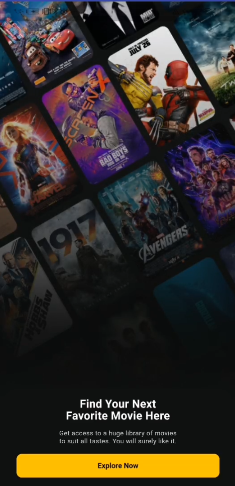</a><br><b>01 · البداية</b><br><sub>Find your next favorite movie</sub></td>
    <td align="center"><a href="docs/screenshots/onboarding-02.png">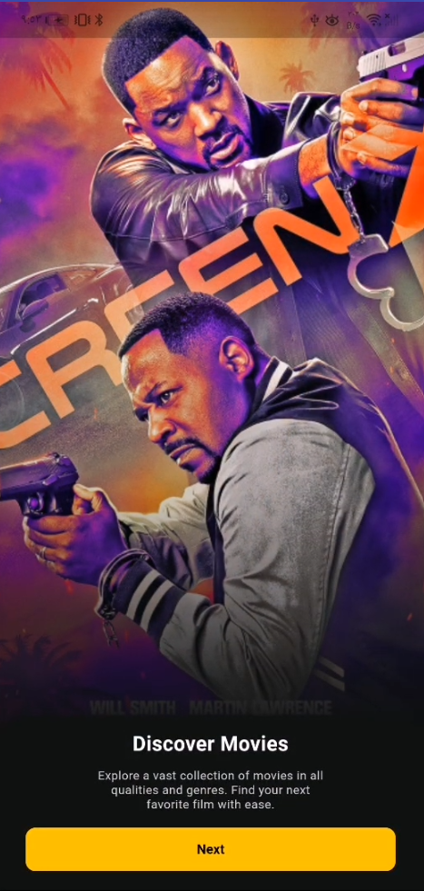</a><br><b>02 · اكتشاف الأفلام</b><br><sub>Discover movies</sub></td>
    <td align="center"><a href="docs/screenshots/onboarding-03.png">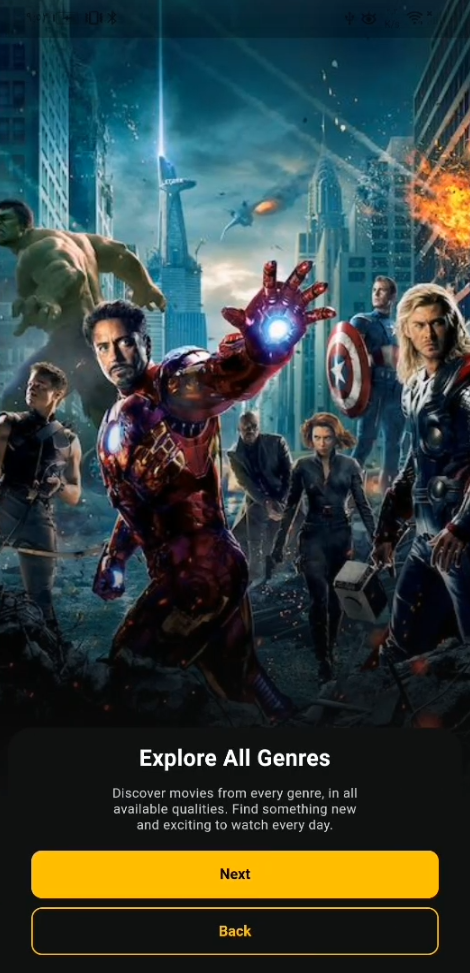</a><br><b>03 · استكشاف الأنواع</b><br><sub>Explore all genres</sub></td>
  </tr>
  <tr>
    <td align="center"><a href="docs/screenshots/onboarding-04.png">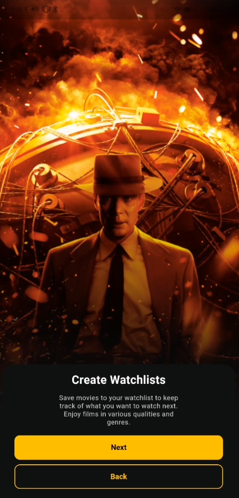</a><br><b>04 · قائمة المشاهدة</b><br><sub>Create watchlists</sub></td>
    <td align="center"><a href="docs/screenshots/onboarding-05.png">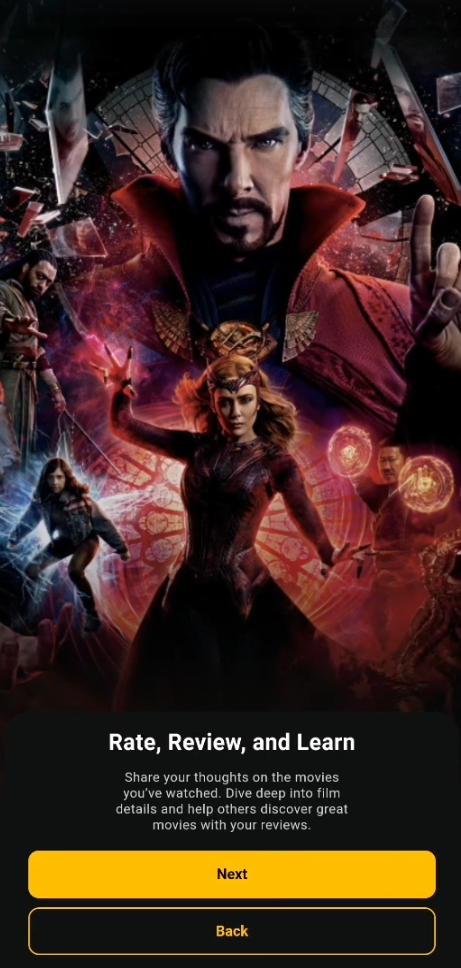</a><br><b>05 · تفاصيل الأفلام</b><br><sub>Rate, review, and learn</sub></td>
    <td align="center"><a href="docs/screenshots/onboarding-06.png">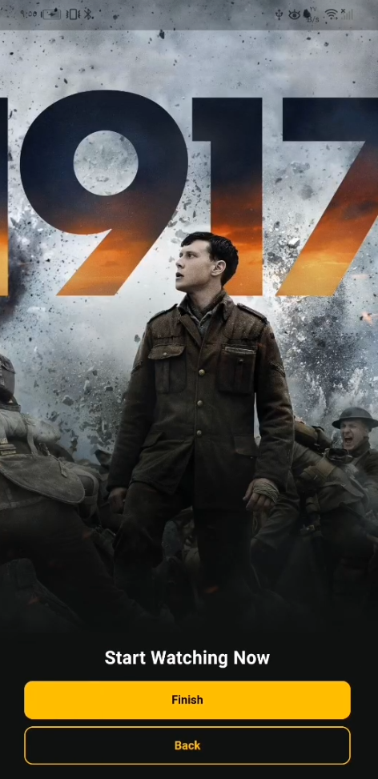</a><br><b>06 · ابدأ الآن</b><br><sub>Start watching now</sub></td>
  </tr>
</table>

### 02 · Main experience — التجربة الأساسية

<table>
  <tr>
    <td align="center"><a href="docs/screenshots/login.png">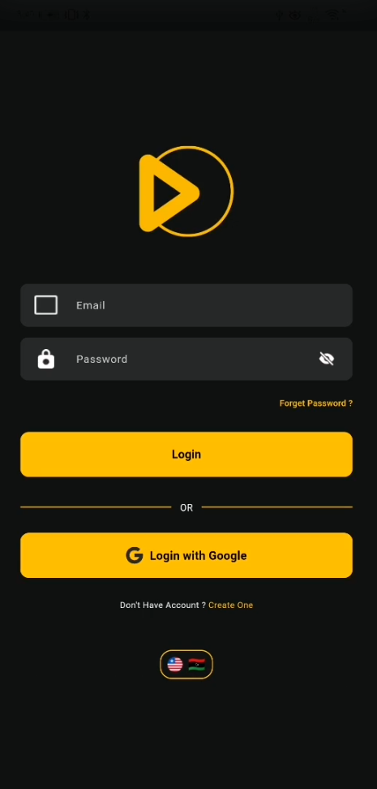</a><br><b>Login</b><br><sub>تسجيل الدخول بالبريد أو Google<br>والتبديل بين العربية والإنجليزية</sub></td>
    <td align="center"><a href="docs/screenshots/register.png">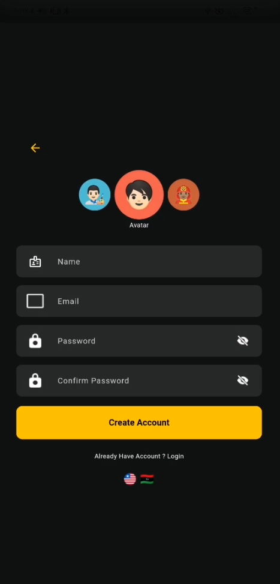</a><br><b>Register</b><br><sub>إنشاء حساب جديد<br>بالاسم والبريد وكلمة المرور</sub></td>
    <td align="center"><a href="docs/screenshots/home.png">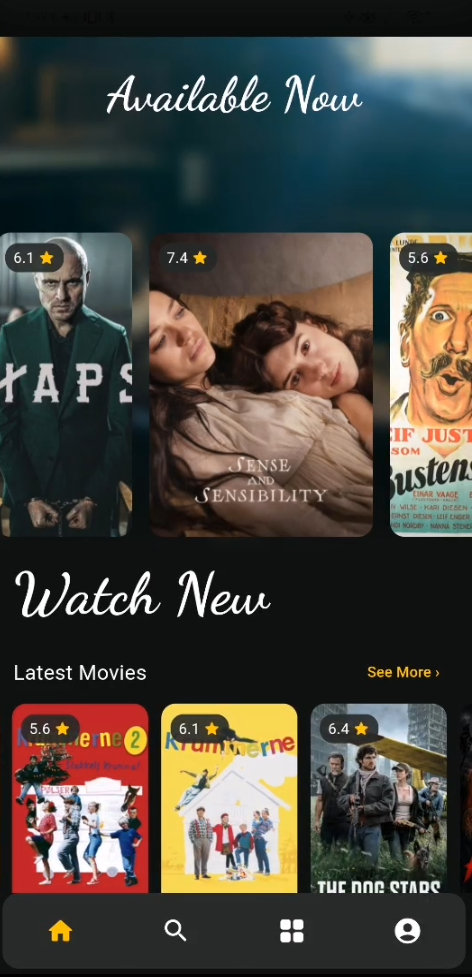</a><br><b>Home</b><br><sub>أفلام مميزة وأحدث الأفلام<br>مع شريط تنقل سفلي</sub></td>
  </tr>
  <tr>
    <td align="center"><a href="docs/screenshots/search.png">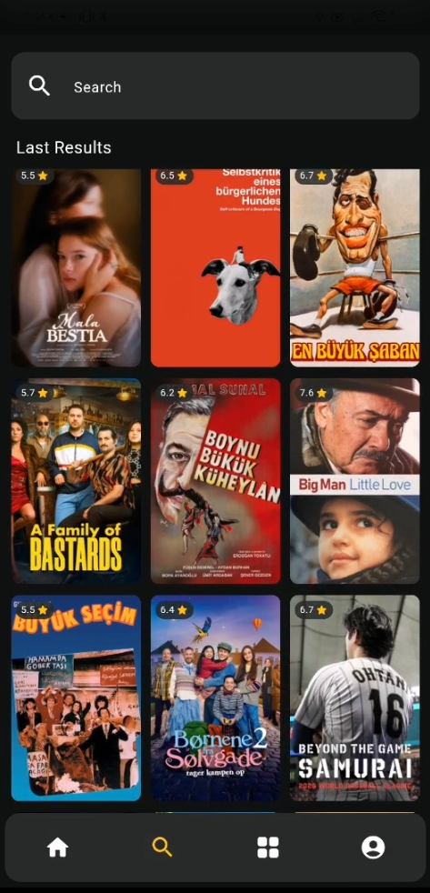</a><br><b>Search</b><br><sub>البحث عن فيلم وعرض<br>آخر نتائج البحث المحفوظة</sub></td>
    <td align="center"><a href="docs/screenshots/browse.png">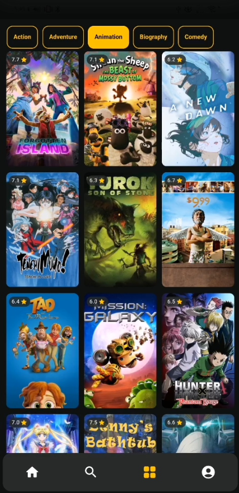</a><br><b>Browse</b><br><sub>تصفية الأفلام حسب النوع<br>وعرضها في شبكة ملصقات</sub></td>
    <td align="center"><a href="docs/screenshots/movie-details.png">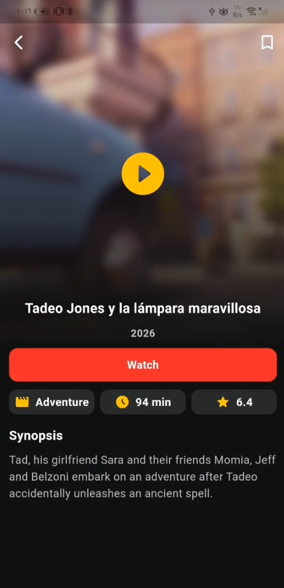</a><br><b>Movie Details</b><br><sub>تفاصيل الفيلم والتقييم والملخص<br>والإضافة إلى قائمة المشاهدة</sub></td>
  </tr>
</table>

> توجد أيضًا شاشات استعادة كلمة المرور، الملف الشخصي، وقائمة المشاهدة داخل التطبيق؛ الصور أعلاه هي اللقطات المتوفرة لهذه النسخة من README.

## Features

| الجزء | الموجود حاليًا |
| --- | --- |
| **الدخول والحساب** | إنشاء حساب وتسجيل الدخول بالبريد وكلمة المرور، تسجيل الدخول عبر Google، استعادة كلمة المرور، وتسجيل الخروج باستخدام Firebase Authentication. |
| **الصفحة الرئيسية** | عرض أفلام مميزة وأحدث الأفلام ببيانات وملصقات من YTS API. |
| **البحث** | بحث عن الأفلام مع تأخير قصير أثناء الكتابة، وإظهار آخر نتائج البحث المحفوظة محليًا. |
| **التصفح** | عرض الأفلام حسب النوع: Action وAdventure وAnimation وBiography وComedy. |
| **تفاصيل الفيلم** | الملصق، العنوان، سنة الإصدار، النوع، المدة، التقييم، الملخص، وخيارات الجودة المتوفرة. |
| **قائمة المشاهدة** | إضافة الأفلام وإزالتها، مع مزامنة قائمة كل مستخدم عبر Cloud Firestore. |
| **التشغيل والسجل** | اختيار جودة التورنت وتشغيله على Android، وتسجيل الفيلم الذي يبدأ تشغيله في سجل محلي باستخدام Hive. |
| **التخزين المحلي** | حفظ الأفلام المميزة وآخر نتائج البحث لتظهر عند تعذر الاتصال، مع حفظ سجل المشاهدة وتفضيل اللغة. |
| **اللغة** | التبديل بين العربية والإنجليزية من واجهة الدخول، مع تذكر الاختيار عند فتح التطبيق لاحقًا. |

## Architecture

المشروع منظّم حسب الميزة، وداخل كل ميزة تُفصل طبقات **presentation / domain / data** وفق Clean Architecture وMVVM. تستخدم شاشات البيانات والمصادقة والمشغّل `Cubit` من `flutter_bloc` لإدارة حالات التحميل والنجاح والخطأ، بينما تستخدم شاشة التعريف `ChangeNotifier` لتتبع الصفحة الحالية.

```text
lib/
├── app/                 # إعداد التطبيق، المسارات والثيم
├── core/                # الخدمات المشتركة، حقن الاعتماديات واللغة
├── features/
│   ├── auth/            # الدخول، التسجيل واستعادة كلمة المرور
│   ├── onboarding/      # شاشات التعريف
│   ├── home/            # الرئيسية، البحث، التصفح، التفاصيل والمشغّل
│   ├── watchlist/       # قائمة المشاهدة على Firestore
│   ├── history/         # سجل المشاهدة المحلي على Hive
│   └── profile/         # الملف الشخصي
└── main.dart
```

**التقنيات:** Flutter · Dart · Firebase Authentication · Cloud Firestore · YTS API · Hive CE · flutter_bloc · video_player.

---

<div align="center"><sub>Built with Flutter · Screenshots captured on Android</sub></div>
